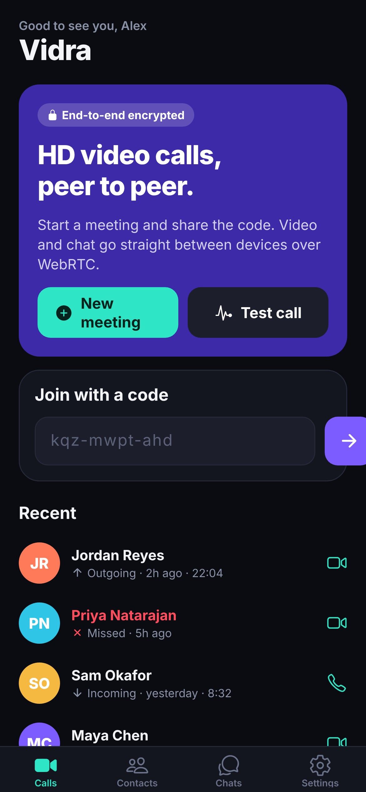
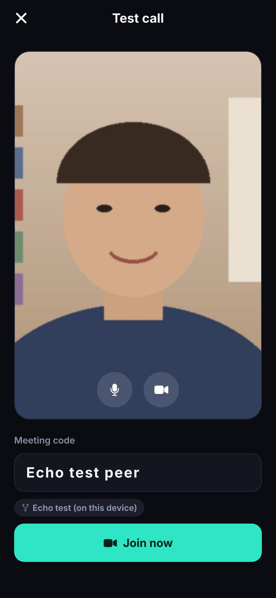
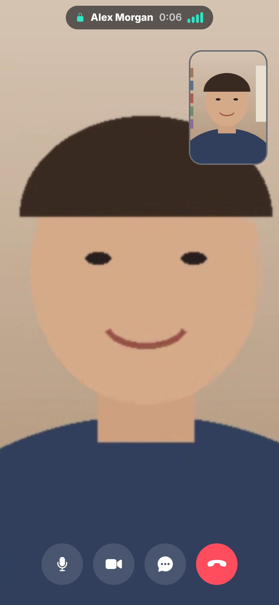
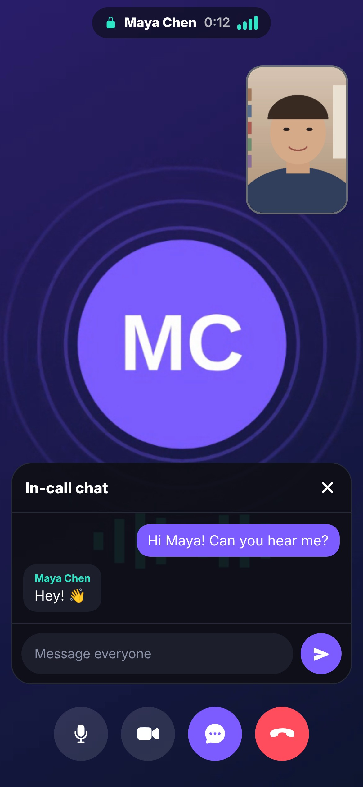
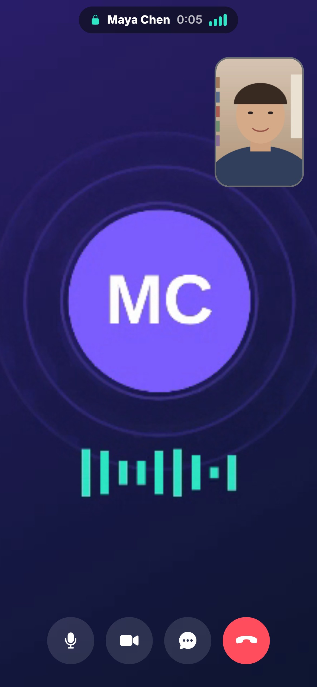
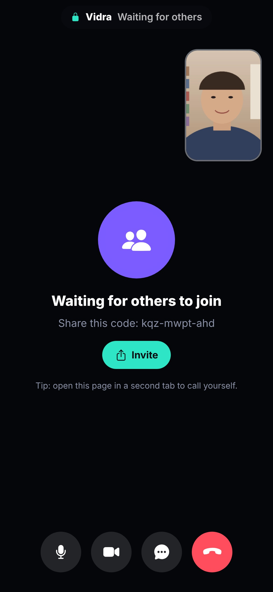
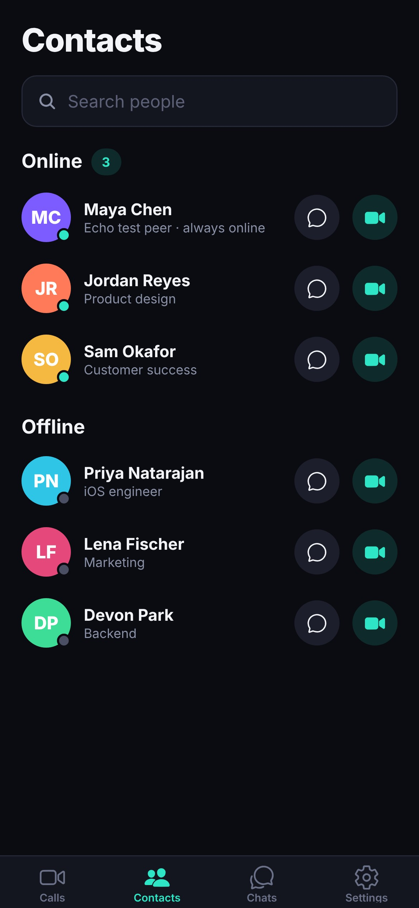
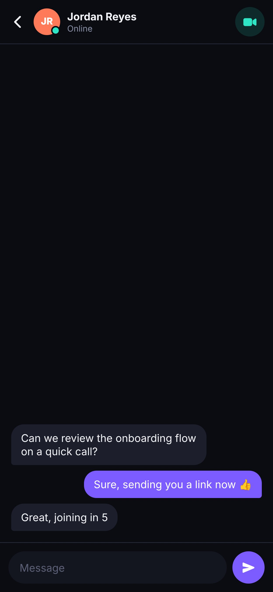

# Vidra: video calling & chat app (React Native + WebRTC)

A **React Native (Expo) + TypeScript** app for **HD 1:1 video calls with in-call chat**, built on **WebRTC**. Audio, video and chat go **peer to peer** (DTLS-SRTP encrypted); a tiny signaling layer only swaps the connection details. One codebase runs on **Android, iPhone and the web**.

<p>
  
  
  
  
</p>
<p>
  
  
  
  
</p>

## Try it

| Platform | How |
| --- | --- |
| **Web (any browser)** | [neomaverick1.github.io/vidra](https://neomaverick1.github.io/vidra/). Tap **Test call**, or tap **New call**, copy the code and open the same page in a **second tab** to call yourself, peer to peer. |
| **Android 7+** | Download `Vidra.apk` from the [latest release](https://github.com/neomaverick1/vidra/releases/latest). |
| **iPhone simulator** | Download `Vidra-iOS-Simulator.zip` from the same release, unzip and drag the app onto a booted simulator. |

Every push to `main` type-checks, lints, runs the tests, builds the Android APK, the iOS simulator app and the web app, deploys the web app to GitHub Pages and publishes a release ([`.github/workflows/build.yml`](.github/workflows/build.yml)).

## Features

| Area | What it does |
| --- | --- |
| **Video calls** | 720p camera, echo cancellation and noise suppression, mute, camera on/off, front/back camera switch (phones), picture-in-picture self view, call timer. |
| **Perfect negotiation** | Either side can (re)negotiate at any time without "glare": the peer with the larger id is *polite* and rolls back on offer collisions. Candidates that arrive early are queued until the remote description is set. |
| **In-call chat** | Messages travel over an **RTCDataChannel** (no server), with typing indicator, unread badge and duplicate protection. |
| **Connection quality** | Reads `getStats()` every 2 s (round-trip time, packet loss, jitter, bitrate) and shows a 4-bar signal indicator. |
| **Data saver** | Caps video at 500 kbps by rewriting the SDP (`b=AS`). Codec preference helper included. |
| **Signaling, three ways** | **Echo test peer** on the same device (a second real peer connection, so the full offer/answer/ICE path runs), **browser tabs** via BroadcastChannel, or any device over a **WebSocket relay** (`server/relay.js`, 40 lines). |
| **Lobby** | Camera preview, join muted / camera off, shareable meeting codes like `kqz-mwpt-ahd` (paste a code or a link). |
| **Contacts & chats** | Presence dots, search, message threads, call history (incoming, outgoing, missed) saved on the device. |
| **Settings** | Display name, join muted, join with camera off, data saver; shows the STUN servers and signaling in use. |

## Architecture

```
src/
  lib/          pure TypeScript, unit-tested
    session.ts    CallSession: peer connection lifecycle, perfect negotiation, data-channel chat, stats
    signaling.ts  Signaling interface + in-memory bus, BroadcastChannel and WebSocket transports
    sdp.ts        codec preference and bitrate caps
    quality.ts    getStats() parsing and the signal-bar score
    chat.ts       data-channel message validation and ordering
    room.ts       meeting codes and invite links
  rtc/          platform layer: react-native-webrtc on phones (webrtc.tsx), browser WebRTC on the web (webrtc.web.tsx), echo peer
  app/          expo-router screens: tabs (calls, contacts, chats, settings), lobby, call, chat
  state/        app store persisted with AsyncStorage
server/relay.js WebSocket signaling relay for calls between any two devices
```

**Tests (Jest, 15):** a full two-peer call through `CallSession` with fake peer connections (discovery, negotiation, connection state, chat both ways, hang-up), SDP rewriting, stats parsing and scoring, chat validation, meeting codes and formatting.

## Calls between two phones

The demo build signals through the echo peer and browser tabs, so it needs no server. To call between any two devices, run the relay and point the app at it:

```bash
npm i ws && node server/relay.js          # listens on :8787
EXPO_PUBLIC_SIGNALING_URL=wss://your-host npx expo start
```

Add a TURN server to `ICE_SERVERS` in `src/lib/session.ts` for strict corporate networks.

## Build it yourself

```bash
npm ci
npm test && npm run typecheck && npm run lint
npx expo start --web                          # browser
npx expo prebuild && npx expo run:android     # native (react-native-webrtc needs a dev build, not Expo Go)
```

## Stack

React Native 0.88 · Expo SDK 58 · expo-router · TypeScript · react-native-webrtc · WebRTC (RTCPeerConnection, RTCDataChannel, getStats) · AsyncStorage · Jest · GitHub Actions · GitHub Pages

MIT licensed.
